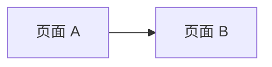

# 交互：<taskId>

## 沿用的交互资产

| 资产 | 差异 |
|---|---|
| 无 / <资产名> | |

## 页面清单

| 页面 | 路由 | 新增 / 修改 | 说明 |
|---|---|---|---|
| | | | |

## 页面流程

## 页面状态

每页至少覆盖空、加载、错误、无权限；不适用时写理由。

| 页面 | 状态 | 触发条件 | 用户看到什么 | 口径说明 |
|---|---|---|---|---|
| | 正常 | | | |
| | 空 | | | |
| | 加载 | | | |
| | 错误 | | | |
| | 无权限 | | | |

## 关键交互

| 交互 | 页面 | 行为 |
|---|---|---|
| | | |

## 验收标准对应

| 验收标准 | 页面 | 状态或交互 |
|---|---|---|
| AC-1 | | |
