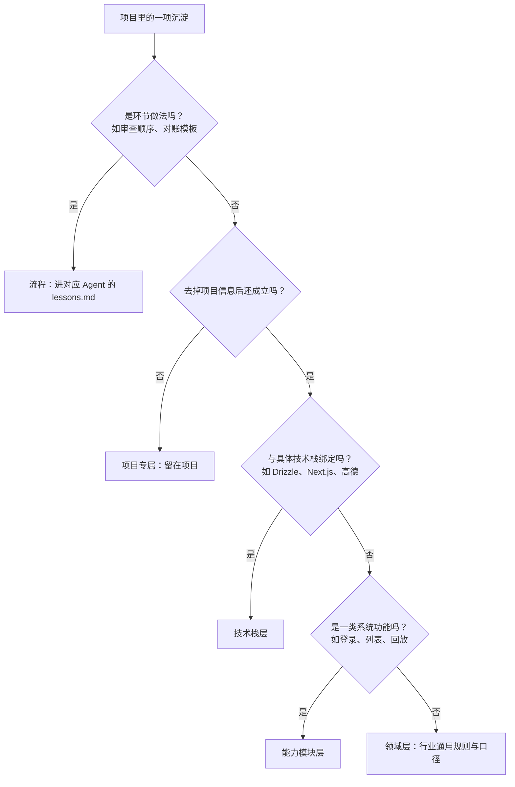

# 资产库设计稿

> **文档 ID：** `ASSET-LIBRARY-v0`
> **状态：** 设计草稿，未实施。落地对应 [agent-architecture.md](agent-architecture.md) §11.1 第 5、6 步
> **配套：** [ai-native-optimization.md](ai-native-optimization.md) §2（四层）· [agent-architecture.md](agent-architecture.md) §8（资产分片与提升闭环）

---

## 1. 定位

标准库里有三类东西，回答三个不同的问题：

| 类别 | 回答什么 | 放在哪 | 例子 |
|---|---|---|---|
| 流程 | 每个环节**怎么做** | `.cursor/rules/`、`agents/` 能力包 | 需求怎么对齐、提交前怎么审查 |
| 资产 | **做过什么**，下一个项目可以直接沿用 | `assets/` | 登录权限、后台列表、轨迹回放、对账 |
| 项目专属 | 只在某个项目成立 | 各项目自己的仓库，不进标准库 | 客户名、地名、坐标、外部协议字段表、具体口径数值 |

资产库的目标：项目甲做过的系统能力，项目乙遇到同类需求时**只填差异**，不重新设计、不重新踩坑。

---

## 2. 什么适合进资产库

### 2.1 准入判据（四条同时满足）

| # | 判据 | 怎么判断 |
|---|---|---|
| 1 | **会再出现** | 已在 2 个及以上项目出现；或只出现过 1 次，但同类系统（后台、大屏、数据服务）几乎必有 |
| 2 | **去掉项目信息后仍成立** | 把客户名、地名、数值、字段表全部删掉，剩下的做法、状态、规则还完整 |
| 3 | **能写出配置点** | 能说清哪些固定、哪些由项目填写（如角色数、数据范围维度、半径、刷新间隔） |
| 4 | **有可验证的东西** | 至少一项：契约测试、检查脚本、验收点、已知坑 |

只满足前两条的，先进候选清单（§5），不入库。

### 2.2 一律不进

- 客户、合作方、项目名称，地名与坐标，具体像素与配色值
- 外部标准或合作方协议的字段表、对账细节
- 只在一个项目成立的口径数值（如某个半径、某个阈值）
- 连接串、账号、密钥、生产数据样本
- 项目级红线的具体条款（如某项目禁止回填）：做法可以抽象成资产，条款本身留在项目扩展

### 2.3 判定顺序



---

## 3. 分层与目录

流程层就是现有的 Rule 与 `agents/` 能力包，不放在 `assets/` 下。其余三层：

```
assets/
├── README.md              # 索引：每个资产一行（层、名称、状态、版本、适用类型与技术栈）
├── stack/<name>/          # 技术栈层：guard、harness 层、接入方式
├── capabilities/<name>/   # 能力模块层：一类系统功能
└── domains/<name>/        # 领域层：行业规则、通用口径
```

### 3.1 单个资产的结构

```
<asset>/
├── ASSET.md     # 必有：元信息 + 适用范围 + 配置点 + 已知坑
├── product.md   # 产品规范：沿用的能力与交互（需求 Agent 用）
├── flow.md      # 页面流程与状态（交互 Agent 用）
├── ui.md        # 组件与样式约定（视觉 Agent 用）
├── contract.md  # 数据模型与接口契约（架构 Agent 用）
├── code/        # 模板代码（研发 Agent 用）
└── tests/       # 契约测试或检查脚本（测试 Agent 用）
```

只有 `ASSET.md` 必有；其余按资产性质取用，例如技术栈层的 guard 只有 `ASSET.md` 与 `tests/`。

`ASSET.md` 头部元信息：

| 字段 | 说明 |
|---|---|
| `id`、`layer` | 唯一标识；`stack` / `capability` / `domain` |
| `status`、`version` | 见 §4 |
| `appliesTo` | 项目类型（A/B）、技术栈 |
| `sources` | 来源项目代号与任务序号（§6），不写真实名称 |
| `usedBy` | 正在使用的项目代号与版本 |

### 3.2 与现有内容的关系

| 现有 | 去向 |
|---|---|
| `docs/product-templates/login.md` | `assets/capabilities/login-permission/product.md`，再补其他分片 |
| 本机 `~/.cursor/skills` 的 `web-*`、`nextjs-fullstack-webapp` 等 | 技术栈层（与 agent-architecture §10.4 一致） |
| `amap-logistics-map` | 技术栈层（高德地图）与领域层（物流）拆开存放 |

---

## 4. 状态与版本

| 状态 | 条件 | 使用方式 |
|---|---|---|
| 候选 | 进了候选清单，未过准入审核 | 不可安装 |
| 试用 | 过准入审核，1 个项目在用 | 可安装；需求 Agent 命中时提示“试用” |
| 稳定 | 2 个及以上项目在用，契约测试或检查可回放 | 默认沿用 |
| 废弃 | 被替代或长期无人使用 | 写明替代者；已安装项目在升级时提示 |

- 版本号：改配置点或契约是大版本；补分片、补已知坑是小版本。
- 项目锁定文件（ai-native-optimization §3.5）记录装了哪些资产、哪个版本；资产升级与标准库升级走同一条命令。
- 模板代码起步时复制进项目并记录版本；同一份代码被 3 个以上项目复制后，再考虑抽成内部包。

---

## 5. 怎么进库

沿用 agent-architecture §8.2 的提升闭环，补上资产专属的字段与审核。

1. **触发**：每次提交前审查、每次线上问题修复、每次 PR 被打回；以及每个任务 CP-09 收尾时问一句“这次做的功能，别的系统会不会也要”。
2. **写候选**：在项目的 `.sdlc/upstream-candidates.md` 追加一条：

   | 字段 | 内容 |
   |---|---|
   | 候选名 | 通用名称，不带项目信息 |
   | 建议层 | 按 §2.3 判定 |
   | 通用部分 | 做法、状态、规则 |
   | 项目专属部分 | 列出要去掉的内容（只在项目内可见） |
   | 配置点 | 哪些由项目填写 |
   | 可验证项 | 契约测试、检查、验收点或已知坑 |

3. **审核**：维护人按 §2.1 四条判据审；通过后在标准库提 PR，内容只含通用部分，状态为“试用”。**不允许 Agent 直接写入标准库。**
4. **转稳定**：第二个项目装上并跑通契约测试后，改为“稳定”。

---

## 6. 来源代号与去标识

资产、经验（`lessons.md`）、评测（`evals.md`）都要写来源，以便追溯和审核；但标准库里**只写代号**。

- 项目代号用天干：项目甲、项目乙、项目丙、项目丁……；任务写成“甲-01”这样的序号。
- 代号与真实项目、任务、文件路径的对照表放在标准库之外（维护人本机或公司内部文档），不入库。
- 评测任务写成去标识的场景（如“按行政区统计一个累计指标”），不写真实任务名与数值。
- 地名、客户名、合作方名称出现在任务名或文件名中时，同样替换。

---

## 7. 各 Agent 怎么用

| Agent | 何时查 | 读哪个分片 | 产出里怎么写 |
|---|---|---|---|
| 需求 | 开工对齐需求时先查 `assets/README.md` | `product.md`、`ASSET.md` 配置点 | 对齐表分“沿用（资产 id@版本）”与“本系统差异”；沿用项不重新设计 |
| 交互设计 | 需求命中资产时 | `flow.md` | 只写差异页面与状态 |
| 视觉设计 | 需求命中资产时 | `ui.md` | 沿用组件约定，只写差异 |
| 架构 | 设计方案时 | `contract.md`、技术栈层 | 沿用契约；偏离须写理由 |
| 研发 | 实现时 | `code/` | 从模板起步；记录资产版本 |
| 测试 | 出用例时 | `tests/` | 契约测试直接纳入；未纳入写理由 |
| 审查与发布 | 提交前审查 | 全部 | 检查实现是否偏离已沿用的资产；判断有无新的候选 |

---

## 8. 首批候选清单

来自 4 个已接入项目的盘点（代号见 §6），**均为候选**，进入第 5 步时逐项按 §2.1 审核。

### 8.1 技术栈层

| 候选 | 来源 | 适用 | 通用部分 |
|---|---|---|---|
| Drizzle migration 账本与完整性检查 | 甲 | Node + PostgreSQL + Drizzle | 防 migration 回退、重复建表导致空库重放失败 |
| 统一连库入口与远程库授权标记 | 乙 | 有数据库的 Node 服务 | 所有脚本经同一入口连库，远程库须带授权标记 |
| Next.js 客户端与服务端边界检查 | 甲 | Next.js | 防止客户端代码引入数据库模块 |
| 生产构建产物检查 | 甲 | 前端需在构建时注入配置的项目 | 检查构建产物里关键配置已注入 |
| mock 数据写库隔离 | 甲 | mock 与真实数据双模的项目 | mock 模式禁止写真实库 |
| harness 真实库测试层、渐进接入 | 乙、丙 | 有数据库的服务；新项目 | `ci` 含真实库测试；按功能逐层加门禁 |
| 常量字面量扫描（如分页大小） | 甲 | TypeScript 项目 | 扫描散落的魔法数字 |
| 高德地图加载、样式与主题联动 | 丁；本机 `amap-logistics-map` | 有地图的 A 类项目 | 单例加载、深浅主题联动地图样式、调参常量集中 |
| 本机全局 Web Skill | 本机 `web-*` 等 | Next.js 全栈 | 接口、请求封装、数据库设计、单测、组件规范 |

### 8.2 能力模块层

| 候选 | 来源 | 适用 | 通用部分 |
|---|---|---|---|
| 登录与权限（含数据范围） | 甲、丁；现有 `login.md` | 所有 A 类 | 角色、数据可见范围、越权拒绝等契约测试 |
| 后台列表表格 | 甲 | 后台类 A 类 | 列布局规范、列定义约定 |
| 地图轨迹回放 | 丁 | 有地图的 A 类 | 首页轮廓适配与轨迹适配分开；回放结束保持静态轨迹 |
| 地理围栏与区域统计 | 丁 | 有位置数据的系统 | 判断、实时展示、累计拆开实现；改参数时写明是否重算历史 |
| 数据大屏 | 丁 | 大屏类 A 类 | 按页面拆分组件；数字字体与样式变量集中 |
| 外部数据对账 | 丁、乙、丙 | 有外部数据的系统 | 样本、基线、差异、问题清单；对账只读 |
| 跨系统契约与联调 | 丙、乙 | 多系统协作 | 自有契约与外部契约分开；版本字段必填；联调清单 |
| 定时任务与通知 | 本机 `ops-middleware-platform` | 中台、Worker | 幂等执行、重试、执行日志、邮件与企微通知 |

### 8.3 领域层

| 候选 | 来源 | 通用部分 | 待确认 |
|---|---|---|---|
| 物流车队 | 甲、丁；本机 `amap-logistics-map` | 车辆状态口径（如活跃与停驶分开统计）、按车队划分数据可见范围、北京时间自然日 | 哪些口径各项目一致 |
| 碳减排统计 | 丁 | 按区域、时间累计的统计口径与对账方法 | 目前只有 1 个项目，先作候选 |
| 充换电 | 甲 | 金额与电量口径 | 需从项目甲进一步盘点 |

### 8.4 明确不进（留在项目）

具体地图坐标与像素、外部标准字段表、合作方对账细节、具体的半径与阈值、某项目的数据回填禁令条款。

### 8.5 建议首批落地

结合试点项目（项目丁）与已有底稿，第 5 步先做 3 个：**登录与权限**（已有底稿，补数据范围与契约测试）、**地图轨迹回放**（试点项目界面以地图为主，可同时验证交互与视觉 Agent）、**外部数据对账**（3 个项目都遇到，返工最多）。

---

## 9. 落地步骤

| 步 | 内容 | 对应 agent-architecture §11.1 |
|---|---|---|
| 1 | 建 `assets/` 目录、`README.md` 索引、`ASSET.md` 模板；`login.md` 迁入 | 第 5 步 |
| 2 | 做首批 3 个资产，在试点项目上跑通“沿用 + 差异” | 第 5 步 |
| 3 | 候选清单字段、CP-09 复用提问、审核流程 | 第 6 步 |
| 4 | 资产写入锁定文件，随标准库一起安装、升级 | 第 7 步 |

---

## 变更记录

| 日期 | 版本 | 说明 |
|---|---|---|
| 2026-11-25 | v0 | 设计草稿：定位、准入判据、分层目录、状态版本、进库流程、来源代号、各 Agent 用法、首批候选 |
